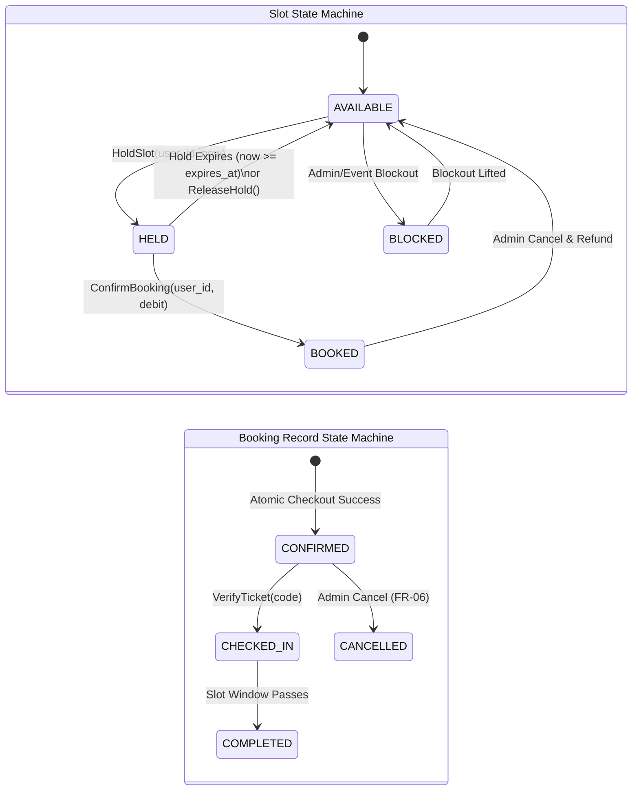
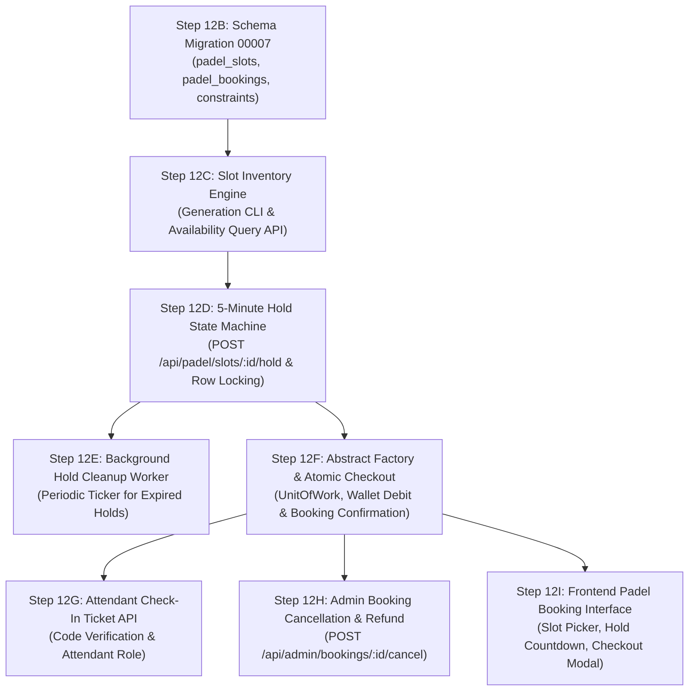

# Padel Court Booking Engine: Architecture & Technical Design

**Document Reference:** `docs/padel-booking-design.md`  
**Milestone:** Phase 6 / Step 12A (Design Only)  
**Authoritative Baseline:** [docs/requirements-baseline.md](file:///d:/giki%20sports%20complex/docs/requirements-baseline.md)  
**Implementation Plan:** [docs/implementation-plan.md](file:///d:/giki%20sports%20complex/docs/implementation-plan.md)  
**Academic Course Specifications:**
- `SE-423 — Software Construction and Development Milestone 1` (Lead: Zohaib Malik)
- `SE-431 — Software Quality Assurance Milestone 1` (Lead: Arman Wali)
**Status:** Design Proposal — No code, schema migrations, or database changes applied in this step.

---

## 1. Traceability & Requirements Mapping

Every proposed component and behavior in this design maps directly to explicit clauses in the SE-423/SE-431 course specifications and the formal requirements baseline. Assumptions and provisional parameters are explicitly demarcated from formal requirements.

### 1.1 Requirements Matrix

| Requirement ID | Source Clause | Formal Requirement Summary | Proposed Design Realization | Classification |
| :--- | :--- | :--- | :--- | :---: |
| **FR-03** | Baseline §3.1; SE-423 §3 Table 2 No. 3; SE-431 §3.2 Table 2 | Padel Court Booking Lifecycle: 5-minute temporary slot hold, conflict prevention, confirmed funded booking with wallet debit, ticket check-in verification. | Two-phase booking state machine (`AVAILABLE` $\rightarrow$ `HELD` $\rightarrow$ `BOOKED`), row-level locked hold acquisition, atomic wallet debit, and ticket check-in endpoint. | **Explicit Baseline** |
| **FR-06** | Baseline §3.1; SE-423 §1.6; SE-431 §3.2 Table 2 | Administrative Cancellation & Single Refund: Authorize administrators to cancel confirmed bookings and issue one refund to user wallet ledger; reject user self-cancellation. | Admin-only cancellation endpoint (`POST /api/admin/bookings/:id/cancel`) executing atomic status transition to `CANCELLED` and posting `PADEL_REFUND` ledger credit. | **Explicit Baseline** |
| **QR-01** | Baseline §3.2; SE-431 §2.3 Table 1 | Reliability: In 100 trials, 50 simultaneous booking attempts for one slot produce at most 1 confirmed booking; rejected contenders incur 0 wallet debit. | PostgreSQL row-level locks (`SELECT ... FOR UPDATE`), transaction isolation, and partial unique constraint `uq_active_slot_booking`. | **Explicit Baseline** |
| **QR-03** | Baseline §3.2; SE-431 §2.3 Table 1 | Functional Suitability: Confirmed charge matches approved pricing; failure injected before commit leaves 0 bookings and 0 partial debits. | Single PostgreSQL transaction binding booking record creation and double-entry ledger debit; full rollback on any failure. | **Explicit Baseline** |
| **QR-04** | Baseline §3.2; SE-431 §2.3 Table 1 | Reliability & Idempotency: Submitting identical user-scoped idempotency key 20 times produces 1 booking and 1 charge; reuse with different payload is rejected. | User-scoped idempotency table and constraint `UNIQUE (user_id, idempotency_key)` storing request fingerprint and original response. | **Explicit Baseline** |
| **QR-08** | Baseline §3.2; SE-431 §2.3 Table 1 | Interaction Capability: $\ge 4$ of 5 representative users complete eligible funded booking within 3 minutes without assistance. | Streamlined frontend calendar view, real-time 5-minute countdown banner, one-click checkout modal, and visual booking ticket confirmation. | **Explicit Baseline** |
| **QR-09** | Baseline §3.2; SE-431 §2.3 Table 1 | Interaction Capability: Zero keyboard traps in slot selection and checkout; 100% of validation failures display explanatory corrective text. | Native modal dialogs or explicit focus-trap containers with Escape/Cancel dismissal returning focus to trigger elements. | **Explicit Baseline** |
| **SE-423 Pattern 1** | SE-423 §6.1 Table 7 | Abstract Factory (Creational): Shared `UnitOfWork` starting a database transaction and supplying a compatible family of repositories (`Bookings()` and `Ledger()`). | `TransactionRepositoryFactory` interface implemented by `PostgresTransactionRepositoryFactory` bound to an active `pgx.Tx`. | **Explicit Academic Req** |
| **SE-423 Worker** | SE-423 §2 Table 1 No. 4 | Asynchronous Concurrency: Background worker to release expired holds. | Resilient ticker background worker scanning `hold_expires_at <= now()` and resetting abandoned slots to `AVAILABLE`. | **Explicit Academic Req** |

---

## 2. Booking Lifecycle & State Transitions

### 2.1 State Transition Model

The booking engine models two distinct entities: the physical court **Slot** (time-bounded inventory) and the customer **Booking** (contractual reservation).



### 2.2 Slot State Specifications

1. **`AVAILABLE`**:
   - The slot is open for reservation.
   - Any authenticated, eligible user may request a temporary hold.
2. **`HELD`**:
   - The slot is reserved exclusively for the holding user (`holder_id`) until `hold_expires_at`.
   - The hold is strictly expired when `now >= hold_expires_at` (Baseline Rule 4.1.2).
   - While valid (`now < hold_expires_at`), requests by other users are rejected with `409 Conflict`.
   - If the holding user abandons checkout, the hold is released either eagerly by the background cleaner or lazily by the next contender.
3. **`BOOKED`**:
   - The slot is confirmed, and the user's wallet has been debited.
   - Guarded by a database uniqueness constraint: at most one active confirmed booking may exist for a slot.
4. **`BLOCKED`**:
   - The slot is administratively closed for maintenance or university athletic tournaments (FR-08).

### 2.3 Booking Record Specifications

1. **`CONFIRMED`**:
   - The booking has been created and paid. A check-in ticket code is generated.
2. **`CHECKED_IN`**:
   - An authorized attendant has verified the user's check-in code at the facility.
3. **`CANCELLED`**:
   - An authorized administrator has cancelled the reservation and triggered an automatic wallet refund.
   - Standard users cannot transition a booking to `CANCELLED` (Baseline Rule 4.1.6).
4. **`COMPLETED`**:
   - The booked time window has passed. Terminal state.

---

## 3. Product Decisions & Policy Parameters (Confirmed by User)

The following operational parameters have been confirmed by the product owner for the Padel Court Booking system:

| Decision Parameter | Confirmed Policy | Architectural Realization |
| :--- | :--- | :--- |
| **Bookable Facility Scope** | Padel Court only (as per SE-423 §1.6). | System restricts online advance reservations exclusively to Padel court facilities. |
| **Slot Duration** | **Default 60 minutes**, with administrator ability to customize/change slot duration. | Stored as discrete `start_time` and `end_time` (`TIMESTAMPTZ`), allowing slots to span 60 minutes by default while enabling administrators to create or adjust slots of any duration. |
| **Slot Pricing** | **Admin-configurable** (admin sets and edits amounts in integer paisa). | Stored per slot as `price_paisa BIGINT NOT NULL`. Admin management endpoints allow updating price dynamically. |
| **Operating Hours** | **Admin-configurable** (admin sets the operating window / schedule). | Admin sets daily operating windows via scheduling tools, driving slot availability. |
| **Booking Availability & Horizon** | When slots are live/available, users can book them until finished or closed. | Slots in `AVAILABLE` state can be held and booked immediately by active users. |
| **Hold Duration** | **Exactly 5 minutes** (`now + 5 minutes`). | Strict baseline requirement (FR-03, SE-423 §3): hold is expired when `now >= hold_expires_at`. |
| **Cancellation Refund** | **100% full refund without deduction**. | In case of administrative cancellation (FR-06), the exact fee paid (`fee_paisa`) is credited back to the user's wallet ledger with zero deductions. |
| **Version 1 Checkout Scope** | Local wallet ledger debit (`SYS_REVENUE`). | Fully atomic single-transaction checkout debiting the user's personal wallet and crediting system revenue. |

---

## 4. Proposed Database Model & Concurrency Strategy

### 4.1 Relational Schema Proposal (`giki_sports`)

```sql
-- Migration 00007: Padel slots, bookings, and check-in tickets

-- 1. Padel Slots (Inventory)
CREATE TABLE giki_sports.padel_slots (
    id UUID PRIMARY KEY DEFAULT gen_random_uuid(),
    facility_id UUID NOT NULL REFERENCES giki_sports.facilities(id) ON DELETE RESTRICT,
    start_time TIMESTAMPTZ NOT NULL,
    end_time TIMESTAMPTZ NOT NULL,
    status VARCHAR(20) NOT NULL DEFAULT 'AVAILABLE',
    holder_id UUID REFERENCES giki_sports.users(id) ON DELETE SET NULL,
    hold_expires_at TIMESTAMPTZ,
    price_paisa BIGINT NOT NULL,
    created_at TIMESTAMPTZ NOT NULL DEFAULT now(),
    updated_at TIMESTAMPTZ NOT NULL DEFAULT now(),

    CONSTRAINT chk_padel_slots_time_valid CHECK (start_time < end_time),
    CONSTRAINT chk_padel_slots_price_non_negative CHECK (price_paisa >= 0),
    CONSTRAINT chk_padel_slots_status CHECK (status IN ('AVAILABLE', 'HELD', 'BOOKED', 'BLOCKED')),
    CONSTRAINT uq_padel_slots_facility_time UNIQUE (facility_id, start_time)
);

CREATE INDEX idx_padel_slots_facility_date 
    ON giki_sports.padel_slots (facility_id, start_time);
CREATE INDEX idx_padel_slots_held_expiry 
    ON giki_sports.padel_slots (status, hold_expires_at) 
    WHERE status = 'HELD';

-- 2. Padel Bookings (Contracts)
CREATE TABLE giki_sports.padel_bookings (
    id UUID PRIMARY KEY DEFAULT gen_random_uuid(),
    slot_id UUID NOT NULL REFERENCES giki_sports.padel_slots(id) ON DELETE RESTRICT,
    user_id UUID NOT NULL REFERENCES giki_sports.users(id) ON DELETE RESTRICT,
    status VARCHAR(20) NOT NULL DEFAULT 'CONFIRMED',
    fee_paisa BIGINT NOT NULL,
    idempotency_key VARCHAR(128) NOT NULL,
    check_in_code VARCHAR(16) NOT NULL,
    checked_in_at TIMESTAMPTZ,
    checked_in_by UUID REFERENCES giki_sports.users(id) ON DELETE SET NULL,
    cancelled_at TIMESTAMPTZ,
    cancelled_by UUID REFERENCES giki_sports.users(id) ON DELETE SET NULL,
    cancellation_reason TEXT,
    debit_transaction_id UUID REFERENCES giki_sports.wallet_transactions(id) ON DELETE RESTRICT,
    refund_transaction_id UUID REFERENCES giki_sports.wallet_transactions(id) ON DELETE RESTRICT,
    created_at TIMESTAMPTZ NOT NULL DEFAULT now(),
    updated_at TIMESTAMPTZ NOT NULL DEFAULT now(),

    CONSTRAINT chk_padel_bookings_fee_positive CHECK (fee_paisa > 0),
    CONSTRAINT chk_padel_bookings_status CHECK (status IN ('CONFIRMED', 'CHECKED_IN', 'CANCELLED', 'COMPLETED')),
    CONSTRAINT uq_padel_bookings_user_idempotency UNIQUE (user_id, idempotency_key)
);

-- Partial Unique Index: Guarantees at most ONE active booking per slot (QR-01)
-- Allows historical CANCELLED records while preventing double-booking of active slots
CREATE UNIQUE INDEX uq_active_slot_booking 
    ON giki_sports.padel_bookings (slot_id) 
    WHERE status IN ('CONFIRMED', 'CHECKED_IN');
```

### 4.2 Concurrency-Safe Hold Acquisition (`SELECT ... FOR UPDATE`)

To prevent two concurrent users from acquiring a hold on the same slot simultaneously (QR-01, Risk R-01):

```sql
-- Executed inside a single PostgreSQL transaction
BEGIN;

SELECT id, status, holder_id, hold_expires_at, price_paisa
FROM giki_sports.padel_slots
WHERE id = $slot_id
FOR UPDATE;

-- Business Logic Evaluation:
-- 1. If status == 'AVAILABLE': Slot is free; grant hold.
-- 2. If status == 'HELD' AND hold_expires_at <= now(): Previous hold expired lazily; grant hold to new contender.
-- 3. If status == 'HELD' AND holder_id == $user_id: Same user refreshing active hold.
-- 4. If status == 'HELD' AND holder_id != $user_id AND hold_expires_at > now(): Active hold exists; RETURN 409 CONFLICT.
-- 5. If status == 'BOOKED' OR status == 'BLOCKED': Slot unavailable; RETURN 409 CONFLICT.

UPDATE giki_sports.padel_slots
SET 
    status = 'HELD',
    holder_id = $user_id,
    hold_expires_at = now() + INTERVAL '5 minutes',
    updated_at = now()
WHERE id = $slot_id;

COMMIT;
```

### 4.3 Hold Expiration Strategy

Holds expire under two coordinated, fail-safe mechanisms:
1. **Lazy Expiration (Just-In-Time)**:
   Any query or acquisition request inspecting the slot evaluates `now() >= hold_expires_at`. If true, the slot is treated as immediately available for re-holding, eliminating race conditions caused by delayed background workers.
2. **Eager Expiration (Background Worker)**:
   A resilient background worker (`cmd/server` support routine) runs every 30 seconds:
   ```sql
   UPDATE giki_sports.padel_slots
   SET status = 'AVAILABLE', holder_id = NULL, hold_expires_at = NULL, updated_at = now()
   WHERE status = 'HELD' AND hold_expires_at <= now();
   ```

### 4.4 Time Zone Representation

- **Storage**: All temporal attributes (`start_time`, `end_time`, `hold_expires_at`, `checked_in_at`, `created_at`) are stored as **`TIMESTAMPTZ`** (UTC).
- **Business Calendar**: Facility opening hours and daily slots are bounded in Pakistan Standard Time (`Asia/Karachi`, UTC+5).
- **API Boundary**: Serialized as ISO 8601 strings with timezone offset (`2026-11-14T10:00:00+05:00`).

---

## 5. Transaction Boundaries & Atomic Checkout

### 5.1 Inspection of Current Service Boundaries

Inspection of the existing codebase reveals that `wallet.Service` does **not** currently accept an external transaction:

```go
// Current implementation in backend/internal/wallet/service.go:
func (s *Service) PostTransactionWithResult(ctx context.Context, params TransferParams) (*PostResult, error) {
    ...
    tx, err := s.pool.Begin(ctx) // Creates its own standalone transaction
    ...
    tx.Commit(ctx)               // Commits independently
    ...
}
```

If a booking service were to call `walletSvc.PostTransactionWithResult` and then insert the booking record into `giki_sports.padel_bookings`:
- The wallet debit commits **before** the booking record is created.
- If the booking insertion fails (e.g. database constraint violation, connection crash), the user has been debited, but has no booking.
- Conversely, creating the booking first risks a booking without a debit if the wallet service rejects the transfer.

### 5.2 Required Architectural Refactoring for Atomicity

To satisfy **QR-03** (*"If failure is injected before transaction commit, both booking and debit roll back completely"*), the booking confirmation and wallet debit **must execute inside the same PostgreSQL transaction**.

Two viable design approaches exist:

#### Approach A: Direct Transaction-Aware Service Method (`PostTransactionTx`)
Refactor `wallet.Service` to extract the core transfer logic into a method accepting a `pgx.Tx`:

```go
// Core transaction-bound transfer logic
func (s *Service) PostTransactionTx(ctx context.Context, tx pgx.Tx, params TransferParams) (*PostResult, error) {
    // Locks wallets, checks funds, inserts header & paired entries using the provided tx
}

// Standalone wrapper for callers without an outer transaction
func (s *Service) PostTransactionWithResult(ctx context.Context, params TransferParams) (*PostResult, error) {
    tx, err := s.pool.Begin(ctx)
    if err != nil { return nil, err }
    defer tx.Rollback(ctx)
    res, err := s.PostTransactionTx(ctx, tx, params)
    if err != nil { return nil, err }
    return res, tx.Commit(ctx)
}
```

*Pros:* Minimal code complexity, highly idiomatic Go, direct reusability of existing `wallet.Service` validation.  
*Cons:* Couples booking workflow directly to `wallet.Service`.

#### Approach B: Abstract Factory Pattern via UnitOfWork (SE-423 §6.1 Requirement)
In academic compliance with SE-423 Section 6.1 (Creational Design Pattern requirement), an `Abstract Factory` coordinates transaction-scoped repositories:

```go
// Creational Abstract Factory Interface
type TransactionRepositoryFactory interface {
    Bookings() BookingRepository
    Ledger() LedgerRepository
}

// UnitOfWork encapsulates transaction lifecycle
type UnitOfWork interface {
    Execute(ctx context.Context, fn func(factory TransactionRepositoryFactory) error) error
}
```

Inside `Execute`, the `PostgresUnitOfWork` starts a `pgx.Tx`, instantiates a `PostgresTransactionRepositoryFactory` passing that `pgx.Tx` to both repositories, and commits only if `fn` returns nil.

### 5.3 Recommendation

We adopt **Approach B (Abstract Factory Pattern)** to satisfy SE-423 mandatory construction requirements while enforcing strict transaction atomicity:
1. `BookingService.Checkout` invokes `UnitOfWork.Execute`.
2. Inside the transaction:
   - Locks the slot row with `SELECT ... FOR UPDATE`.
   - Validates that `status == 'HELD'`, `holder_id == user_id`, and `hold_expires_at > now()`.
   - Debits the user's wallet via `factory.Ledger()` (`TransferParams{Sender: userWallet, Receiver: sysRevenueWallet, Amount: slot.PricePaisa, Type: "PADEL_BOOKING"}`).
   - Inserts the `padel_bookings` row recording `debit_transaction_id`.
   - Updates `padel_slots` status to `BOOKED`.
   - Inserts the audit log entry (`target_type: 'padel_booking'`).
3. If any step fails, the entire database transaction rolls back, leaving 0 ledger entries, 0 bookings, and the slot hold intact.

---

## 6. Security, Auditing, Idempotency & Test Scenarios

### 6.1 Authorization Matrix

| Endpoint | Operation | Allowed Roles | Enforcement Mechanism |
| :--- | :--- | :--- | :--- |
| `GET /api/padel/slots` | Browse slots & availability | Public (Anonymous, Student, Faculty, Director) | Public read; no session required. |
| `POST /api/padel/slots/:id/hold` | Acquire 5-minute slot hold | `student`, `faculty`, `sports_director`, `super_admin` | `RequireAuth` middleware. |
| `POST /api/padel/checkout` | Confirm booking & debit wallet | Slot Holder only (`holder_id == principal.UserID`) | `RequireAuth` + Hold ownership validation. |
| `POST /api/padel/bookings/verify-ticket` | Attendant verify check-in code | `sports_director`, `super_admin`, Attendant | `RequireRole` middleware. |
| `POST /api/admin/bookings/:id/cancel` | Cancel booking & issue refund | `sports_director`, `super_admin` only | `RequireRole` (FR-06 rejects standard users). |

### 6.2 Audit Trail Integration (Migration 00004 Schema)

Every state-changing administrative and financial operation records an audit entry:
- **`booking.hold`**: Captures `actor_id`, `target_type: 'padel_slot'`, `target_id: slot.ID`, details: `{"hold_expires_at": "..."}`.
- **`booking.checkout`**: Captures `actor_id`, `target_type: 'padel_booking'`, `target_id: booking.ID`, details: `{"slot_id": "...", "fee_paisa": 100000, "tx_id": "..."}`.
- **`booking.verify_ticket`**: Captures attendant `actor_id`, `target_type: 'padel_booking'`, `target_id: booking.ID`.
- **`booking.admin_cancel`**: Captures admin `actor_id`, `target_type: 'padel_booking'`, `target_id: booking.ID`, details: `{"refund_tx_id": "...", "reason": "..."}`.

*Sanitization Guarantee:* Payload details strictly omit passwords, session cookies, and authorization tokens.

### 6.3 Idempotency Strategy (QR-04)

1. Client generates a unique `idempotency_key` (UUID v4) on the checkout form.
2. Checkout verifies `UNIQUE (user_id, idempotency_key)`:
   - **First request**: Proceeds with hold confirmation and wallet debit. Commits booking.
   - **Identical replay (same user, key, and slot)**: Detects committed booking, returns original HTTP 200 with stored booking response without issuing duplicate debit.
   - **Conflicting replay (same user & key, different slot or amount)**: Returns `409 Conflict: idempotency key reuse with mismatched parameters`.

### 6.4 Failure Modes & System Recovery

| Failure Scenario | System Behavior | User Feedback |
| :--- | :--- | :--- |
| **Expired Hold (`now >= expires_at`)** | Checkout rejects; slot returned to `AVAILABLE`; 0 wallet debit. | *"Your 5-minute hold has expired. Please select the slot again."* |
| **Stolen Hold Attempt** | User B attempts checkout on User A's hold; rejected with 403/409. | *"You do not have an active hold on this slot."* |
| **Insufficient Wallet Funds** | `wallet.Service` returns `ErrInsufficientFunds`; transaction aborted; slot remains `HELD`. | *"Insufficient wallet balance (PKR 1,000.00 required). Please top up."* |
| **Concurrent Checkout Collision** | 50 simultaneous requests hit same slot; exactly 1 acquires row lock; 49 receive conflict error. | Exactly 1 confirms; 49 see *"Slot has already been reserved."* |
| **Mid-Transaction Database Crash** | PostgreSQL transaction rolls back automatically; 0 bookings, 0 ledger entries. | *"Checkout failed due to a database error. No charges were incurred."* |

### 6.5 Quality Assurance Test Scenarios (RTM v1)

- **`TC-FR-03-01`**: Standard student acquires 5-minute hold, completes checkout, verifies debit in wallet activity.
- **`TC-FR-03-02`**: Checkout rejected 1 second after hold expiry (`hold_expires_at <= now()`); 0 wallet debit.
- **`TC-FR-03-03`**: Attendant verifies 4-digit check-in code; booking status becomes `CHECKED_IN`.
- **`TC-FR-06-01`**: Student attempts self-service cancellation; returns HTTP 403 Forbidden.
- **`TC-FR-06-02`**: Administrator cancels booking; booking becomes `CANCELLED`, slot becomes `AVAILABLE`, exact refund credited to wallet ledger once.
- **`TC-QR-01-01`**: 50 simultaneous checkout requests for single slot across 100 trials; assert exactly 1 succeeds and 49 fail with zero wallet debit.
- **`TC-QR-03-01`**: Injected error on second entry or booking insert rolls back entire transaction cleanly.
- **`TC-QR-04-01`**: Replaying checkout payload 20 times produces exactly 1 confirmed booking and 1 debit.

---

## 7. Sequential Implementation Roadmap

To maintain strict test-driven development (TDD) discipline and prevent large unmanageable PRs, the Padel Booking Engine is broken into small, independently verifiable chunks:



### Detailed Chunk Sequence

1. **Step 12B: Relational Schema Migration (Migration `00007`)**:
   - Create tables `giki_sports.padel_slots` and `giki_sports.padel_bookings`.
   - Add check constraints, foreign keys, and the partial unique index `uq_active_slot_booking`.
   - *Verification:* Forward and rollback migration tests in disposable PostgreSQL database.
2. **Step 12C: Slot Inventory Domain & Availability Read API**:
   - Seed/generator logic for recurring daily Padel court slots.
   - Endpoint: `GET /api/padel/slots?date=YYYY-MM-DD`.
   - *Verification:* API unit and integration tests verifying daily slot retrieval and status filtering.
3. **Step 12D: Concurrency-Safe Hold Acquisition (`POST /api/padel/slots/:id/hold`)**:
   - Implement `HoldSlot` with `SELECT ... FOR UPDATE` row locking.
   - 5-minute expiry enforcement and lazy expiration handling.
   - *Verification:* Concurrent goroutine race tests verifying exactly 1 user acquires hold on an available slot.
4. **Step 12E: Background Hold Expiration Cleaner Worker**:
   - Ticker routine releasing expired holds (`now >= hold_expires_at`).
   - *Verification:* Test clock simulation confirming expired holds return to `AVAILABLE` automatically.
5. **Step 12F: Abstract Factory & Atomic Booking Checkout**:
   - Implement `UnitOfWork` and `TransactionRepositoryFactory` binding `padel_bookings` and `wallet_ledger_entries`.
   - Idempotency key checking and atomic wallet debit.
   - *Verification:* `TC-QR-01` (50 concurrent checkouts), `TC-QR-03` (fault injection rollback), and `TC-QR-04` (replay).
6. **Step 12G: Ticket Check-In Code Verification**:
   - Endpoint: `POST /api/padel/bookings/verify-ticket`.
   - *Verification:* Attendant verification tests; rejection of invalid or already checked-in codes.
7. **Step 12H: Administrative Cancellation & Single Wallet Refund**:
   - Endpoint: `POST /api/admin/bookings/:id/cancel` (Director only).
   - Atomic booking cancellation, slot release, and wallet ledger refund.
   - *Verification:* Role check (rejects students), single refund invariant, and re-booking verification.
8. **Step 12I: Frontend Padel Booking Client**:
   - Day picker, interactive slot matrix with availability badges, 5-minute hold timer banner, and wallet checkout modal with BigInt paisa formatting.
   - *Verification:* Vitest component tests, keyboard navigation (QR-09), and responsive layouts (QR-11).

---

## 8. Summary of Inspected Sources

- **Requirements Baseline**: Verified FR-03, FR-06, QR-01, QR-03, QR-04, and confirmed business rules in [`docs/requirements-baseline.md`](file:///d:/giki%20sports%20complex/docs/requirements-baseline.md).
- **Implementation Plan**: Cross-referenced Phase 6 (Chunks 6.1–6.5) and verification commands in [`docs/implementation-plan.md`](file:///d:/giki%20sports%20complex/docs/implementation-plan.md).
- **Academic Specifications**: Reviewed object-oriented design, SOLID principles, Abstract Factory pattern (§6.1), and RTM v1 in `SE-423 Milestone 1` and `SE-431 Milestone 1` PDFs.
- **Backend Architecture**: Inspected existing PostgreSQL transaction boundaries in [`backend/internal/wallet/service.go`](file:///d:/giki%20sports%20complex/backend/internal/wallet/service.go), session authentication in [`backend/internal/authentication/middleware.go`](file:///d:/giki%20sports%20complex/backend/internal/authentication/middleware.go), and audit trail patterns in [`backend/internal/facility/repository.go`](file:///d:/giki%20sports%20complex/backend/internal/facility/repository.go).
- **AI Handoff Context**: Confirmed guidelines and constraints in [`docs/ai-handoff-context.md`](file:///d:/giki%20sports%20complex/docs/ai-handoff-context.md).
